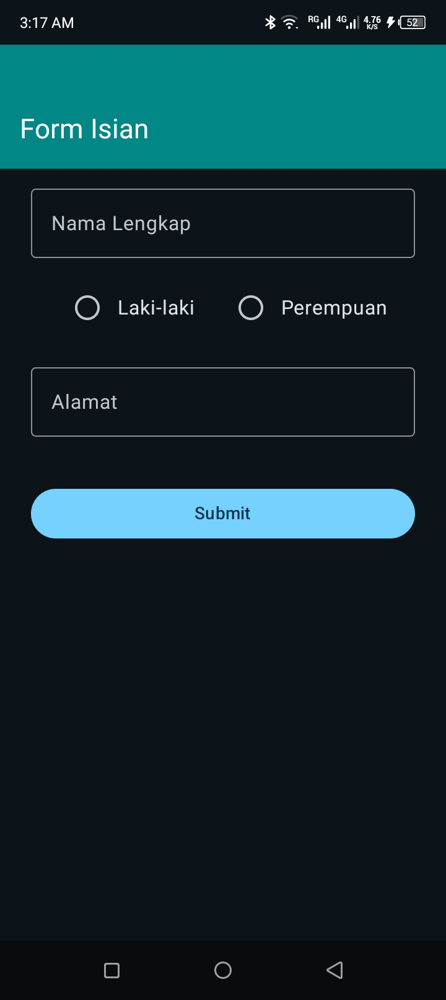
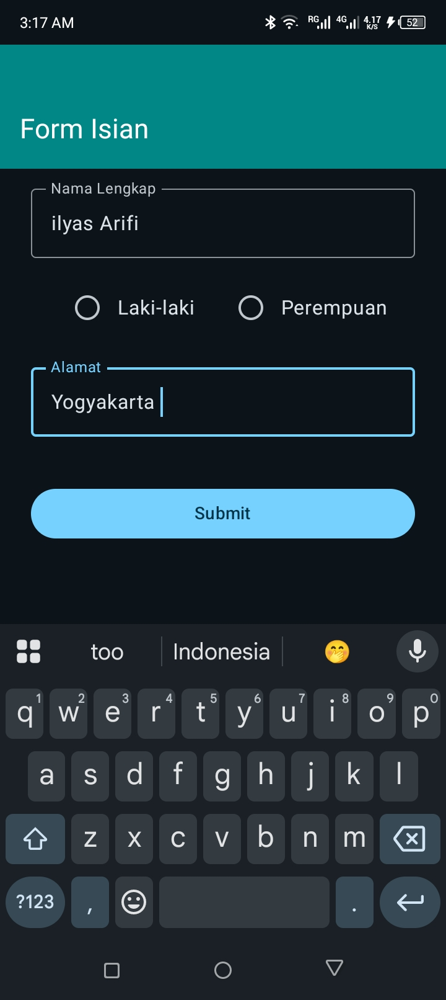
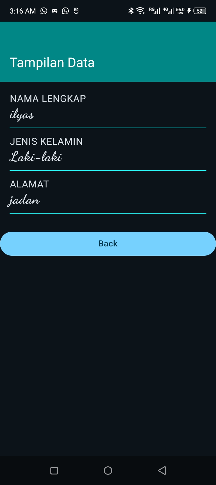

# Navigation and MVVM Implementation

This project demonstrates navigation and basic data passing between screens using Jetpack Compose.

## Screenshots

Here is the flow of the application:

### 1. Empty Form Screen
The initial screen allows the user to enter their details: Name, Gender, and Address.

### 2. Filled Form Screen
The user enters data into the text fields and selects a gender.

### 3. Result Screen
After submitting, the app navigates to a new screen displaying the submitted data.

